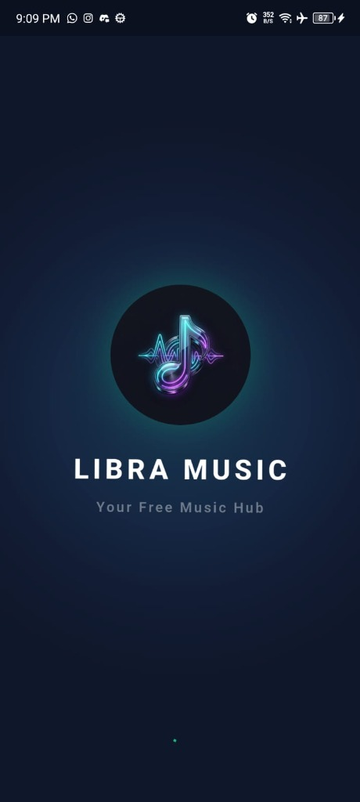
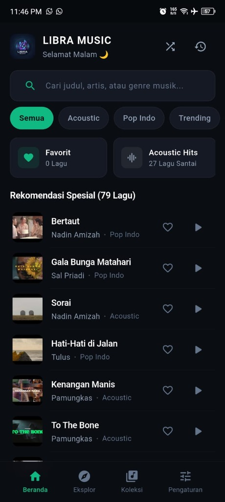
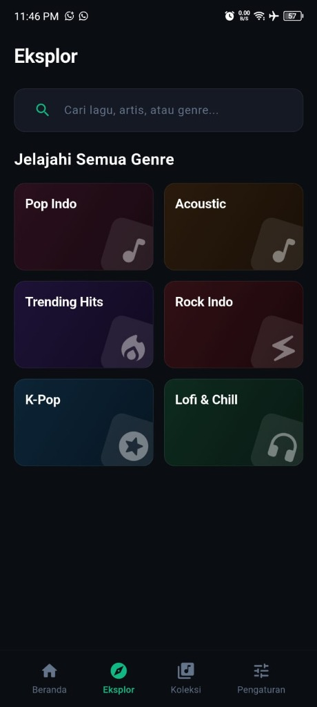
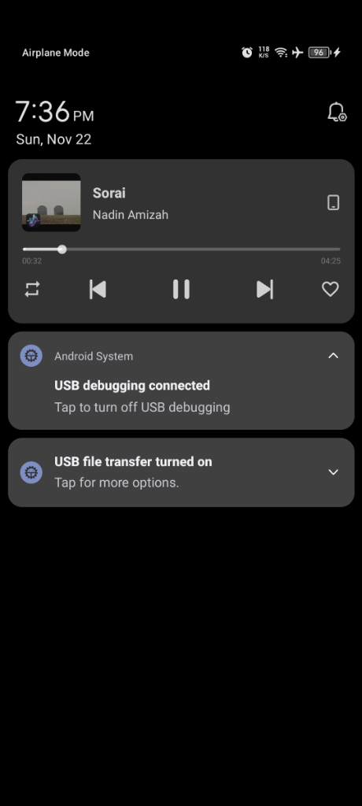
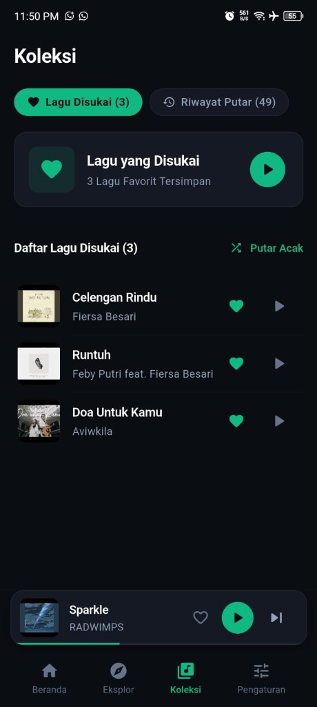
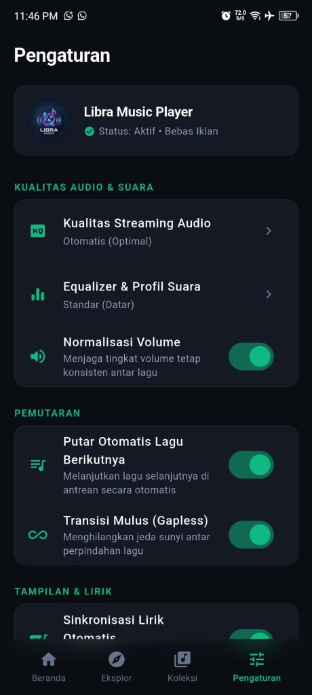
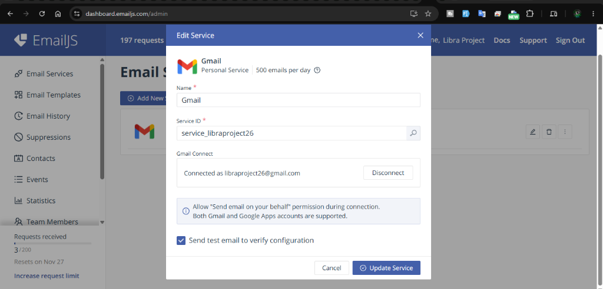
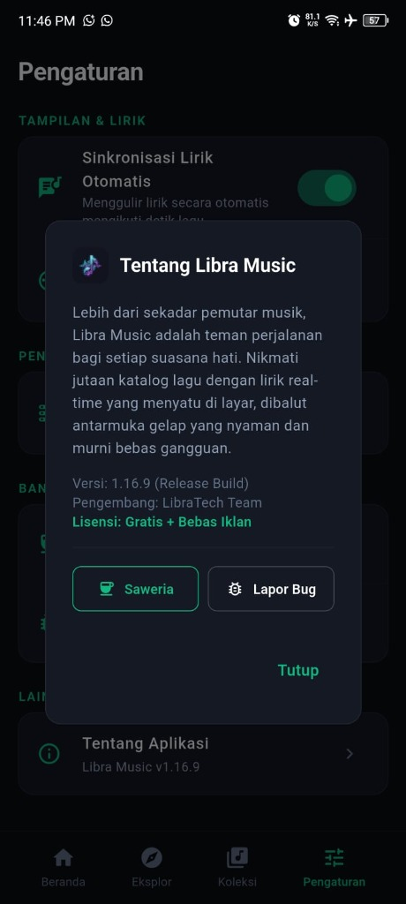
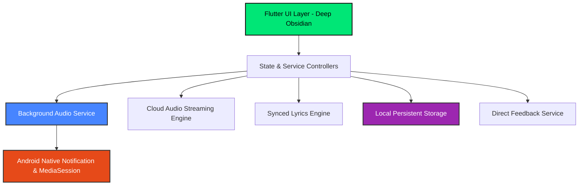

# 🎵 Libra Music - Ad-Free Music Streaming & Synced Lyrics App

> **An elegant, ad-free music streaming player with real-time synchronized lyrics, background audio service, and modern Deep Obsidian UI.**
> 
> *Developed by Libra Tech Team*

---

## 🇮🇩 Ringkasan Proyek (Bahasa Indonesia)

**Libra Music** adalah aplikasi pemutar dan streaming musik modern yang dirancang untuk menghadirkan pengalaman mendengarkan musik yang murni, jernih, dan bebas gangguan iklan. Dibangun dengan framework **Flutter (Dart 3)** dan dioptimalkan dengan **Android Background Audio Service**, Libra Music memungkinkan lo menikmati jutaan katalog lagu dengan lirik karaoke real-time yang menyatu di layar, bahkan saat ponsel terkunci.

### 🌟 Fitur Utama
1. **🚫 100% Bebas Iklan (Ad-Free Experience):** Nikmati musik tanpa jeda iklan audio maupun pop-up banner komersial yang mengganggu.
2. **🎧 Background Playback & Lock Screen Controls:** Musik tetap berputar mulus tanpa terputus saat membuka aplikasi lain atau saat layar ponsel dimatikan, lengkap dengan notifikasi kontrol media native Android.
3. **📜 Lirik Real-Time Sinkron (Karaoke Mode):** Integrasi lirik sinkron otomatis per detik dari layanan database lirik terintegrasi dengan auto-scroll dan penyorotan baris aktif.
4. **🎨 Desain Deep Obsidian (Anti-Carditis UI):** Antarmuka gelap alami yang mewah dengan aksen *Emerald Glow*, nyaman untuk mata dan hemat konsumsi baterai layar AMOLED.
5. **💾 Offline Storage & Smart Cache:** Lagu favorit, riwayat putar, dan antrean tersimpan secara aman dan instan di penyimpanan lokal perangkat tanpa perlu registrasi akun.
6. **🐞 Lapor Masalah & Masukan In-App:** Formulir terintegrasi langsung ke email pengembang untuk menyampaikan kendala pemutaran, request lagu, atau saran fitur.
7. **☕ Dukungan Pengembang:** Dukung keberlanjutan pengembangan aplikasi langsung lewat Saweria (QRIS / E-Wallet).

---

## 🇬🇧 Project Overview (English)

**Libra Music** is an elegant, modern music streaming and playback application crafted to deliver an uninterrupted, ad-free audio experience. Engineered with **Flutter (Dart 3)** and powered by an **Android Background Audio Service**, Libra Music allows you to explore millions of songs with real-time synchronized lyrics on screen, even while multitasking or with your screen locked.

### 🌟 Core Features
1. **🚫 100% Ad-Free:** Zero audio interruptions, banners, or commercial trackers.
2. **🎧 Background Playback & Native Media Notifications:** Uninterrupted audio playback with lock screen controls and system media session integration.
3. **📜 Real-Time Synced Lyrics:** Karaoke-style lyrics synchronized word-by-word/second-by-second powered by an integrated lyrics synchronization engine.
4. **🎨 Deep Obsidian Dark Theme:** Eye-pleasing, battery-friendly dark aesthetic with vibrant Emerald Glow accents.
5. **💾 Local-First Persistence:** Your favorite playlists, history, and cache are preserved locally on-device without requiring account sign-ins.
6. **🐞 In-App Feedback & Bug Reporting:** Native feedback modal communicating directly with developer inboxes via a secure direct-to-email API.
7. **☕ Community Support:** Support future development directly via Saweria (QRIS / Indonesian E-Wallets).

---

## 📸 Screenshots (Tampilan Aplikasi)

> [!TIP]
> **Tampilan Nyata Aplikasi di Perangkat Android:**
> Tangkapan layar antarmuka Libra Music dalam mode gelap Deep Obsidian.

| Splash Screen | Beranda (Home) | Eksplor Genre | Player & Lirik |
| :---: | :---: | :---: | :---: |
|  |  |  |  |

| Koleksi Favorit | Pengaturan | Lapor Kendala | Tentang & Support |
| :---: | :---: | :---: | :---: |
|  |  |  |  |

---

## 🛠️ Tech Stack & Architecture (Teknologi & Arsitektur)

*   **UI Framework:** [Flutter](https://flutter.dev) (Dart 3)
*   **Audio Engine:** Native Android Background Audio Service & MediaSession
*   **Stream & Search Engine:** Cloud Audio Streaming & Search API
*   **Lyrics Provider:** Real-Time Synchronized Lyrics Engine
*   **Local Storage:** On-device Persistent Storage (Favorites, History, & Preferences)
*   **Networking & Feedback:** Secure HTTPS REST API & Direct Feedback Service
*   **Image Caching:** Smart Local Artwork Cache

---

## 🚀 Download & Installation (Panduan Instalasi)

### 📥 Direct Installation (Instalasi Langsung)
Unduh dan pasang langsung file APK siap pakai di perangkat Android Anda:
1. Kunjungi halaman [GitHub Releases](https://github.com/Libra2694/LibraMusic/releases) repositori ini.
2. Unduh file APK rilis terbaru: **`LibraMusic.apk`**.
3. Buka file APK tersebut di ponsel Android Anda dan izinkan instalasi aplikasi dari sumber ini (*Install from Unknown Sources*).
4. Buka aplikasi dan nikmati jutaan musik favorit Anda secara gratis dan bebas iklan!

### 📋 Spesifikasi & Persyaratan Sistem
*   **Platform:** Android (ARM64 / ARMv7 / x86_64)
*   **Ukuran Aplikasi:** ~51.5 MB
*   **Versi Rilis Saat Ini:** `v1.16.9` (Release Build, Obfuscated)
*   **Koneksi:** Membutuhkan internet untuk streaming lagu dan sinkronisasi lirik (koleksi favorit & riwayat tersimpan secara lokal).

---

## 🔒 Privasi & Keamanan (Privacy & Security)

Libra Music sangat menjunjung tinggi privasi pengguna:
- **Tanpa Pendaftaran:** Tidak memerlukan registrasi, login, nomor telepon, atau akun Google.
- **Tanpa Pelacak Komersial:** Aplikasi ini murni bebas dari Google AdMob, Facebook Ads, atau SDK analitik pihak ketiga.
- Kebijakan privasi lengkap dapat dibaca di: 👉 **[PRIVACY_POLICY.md](PRIVACY_POLICY.md)**

---

## 🛡️ License & Developed By

*   **Developer:** Libra Tech Team
*   **Repository:** [https://github.com/Libra2694/LibraMusic](https://github.com/Libra2694/LibraMusic)
*   **Support & Traktir Kopi:** [https://saweria.co/libra2694](https://saweria.co/libra2694)
*   **License:** [MIT License](LICENSE) - Bebas digunakan dan dikembangkan untuk kebaikan bersama.

*Dibuat dengan dedikasi untuk penikmat musik yang menginginkan kesederhanaan, keindahan visual, dan kebebasan mendengarkan tanpa gangguan.*
